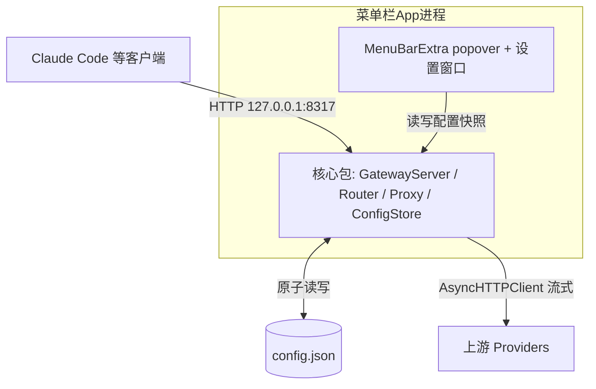
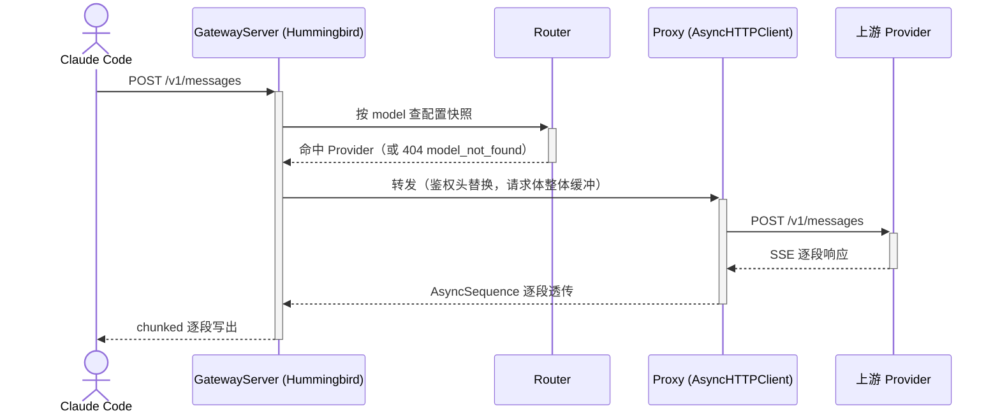
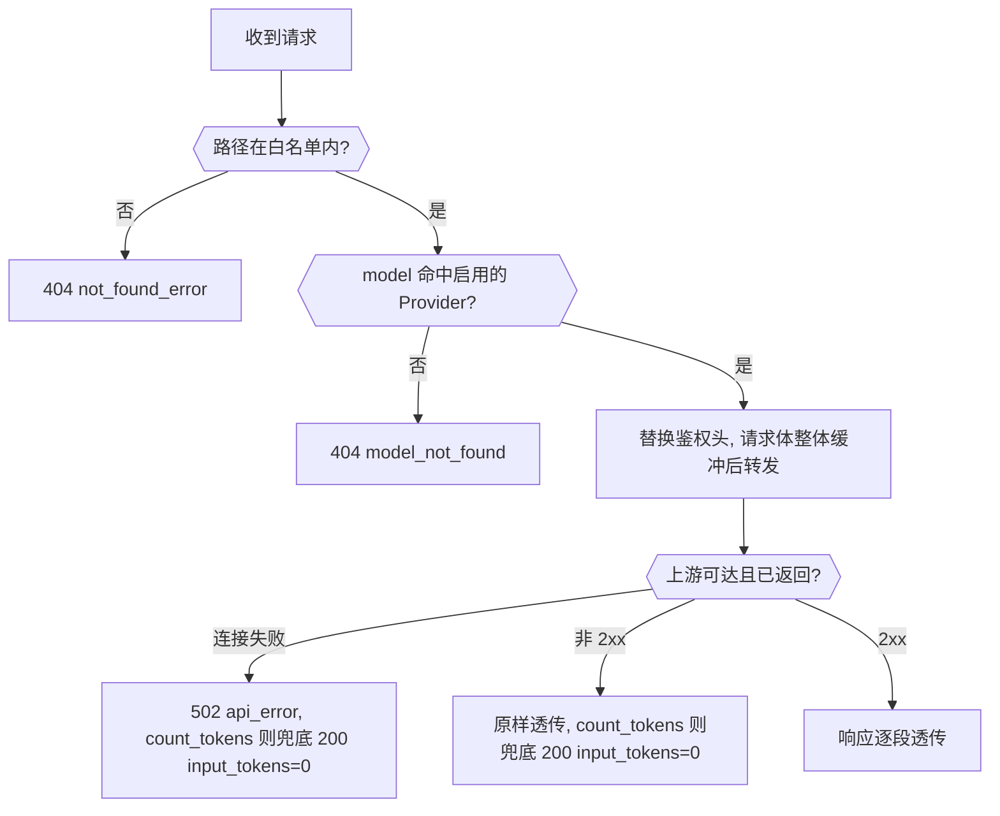

# cc-router-mac Anthropic 网关 技术方案

| 项        | 值                                  |
| --------- | ----------------------------------- |
| 方案状态  | 草稿                                |
| 关联 spec | `.scratch/api-gateway/spec.md`      |
| 版本      | v1.0 (2026-10-23)                   |

# 1 方案概述

## 1.1 背景与目标

Claude Code 等客户端一次只能配一个 base URL 和一个 API key，用户手里的多个 Anthropic 兼容上游无法在一个会话里混用。本方案在 macOS 菜单栏 app 进程内嵌一个本地网关，把多个 Provider 聚合为一个 `127.0.0.1:8317` 端点，按模型归属路由转发，全程不改写报文。目标：Claude Code 指向网关后行为与直连无异（含 SSE 流式），在本机 macOS 27 实测验证通过。

## 1.2 范围

| 维度       | 包含                                                                                     | 不包含（Non-Goals）                                              |
| ---------- | ---------------------------------------------------------------------------------------- | ---------------------------------------------------------------- |
| 业务范围   | `/v1/messages`、`/v1/messages/count_tokens` 转发，`/v1/models` 本地聚合，路由与校验，Switch UI，持久化，登录自启 | 协议转换、故障转移/重试、key 池、`/v1/models/{id}`、客户端鉴权、日志查看器、通配符匹配 |
| 涉及模块   | 核心包（本地 SPM library）+ App 壳（Xcode app target）                                    | —                                                                |
| 上下游系统 | 上游 Anthropic 兼容端点（HTTP）                                                            | OAuth 等第一方流量（不会到达本网关）                               |

## 1.3 技术选型

| 关注点     | 选型                              | 理由                                                |
| ---------- | --------------------------------- | --------------------------------------------------- |
| HTTP server | Hummingbird 2.x                   | 官方 proxy-server 示例与需求对应；流式原生；见 ADR-0001 |
| 上游 client | AsyncHTTPClient                   | 与 server 侧 ByteBuffer 流式一一对应；见 ADR-0001    |
| 进程形态   | 内嵌菜单栏 app 进程                | 免 IPC 与双份状态；见 ADR-0002                       |
| UI         | SwiftUI `MenuBarExtra` + 设置窗口 | macOS 14+ 原生菜单栏 popover（最低系统随技术栈定为 macOS 14，发起人已确认） |
| 持久化     | Application Support 下单 JSON 文件 | 结构化配置、原子写、可人工检查                        |
| 登录自启   | SMAppService.mainApp              | 系统标准 Login Item API（macOS 14+）                  |
| 构建结构   | 核心 SPM 包 + Xcode 薄壳工程        | 核心逻辑可 `swift test` 直测，不依赖 Xcode 启动        |
| 最低系统   | macOS 14                          | Hummingbird 2.28 的 availability macro 要求 macOS 14（发起人已确认放弃 macOS 13，见 ADR-0001 与 Package.swift 注释；本机 macOS 27 / Xcode 27.1 为第一验证环境） |

# 2 架构设计

## 2.1 系统架构



## 2.2 模块职责

| 模块            | 一句话职责                                            | 对外接口                                  |
| --------------- | ----------------------------------------------------- | ----------------------------------------- |
| GatewayServer   | Hummingbird server 生命周期与 `/v1` 路由接入           | Swift API：start / stop / 换配置快照      |
| Router          | 模型归属路由：`model` → 启用 Provider 精确匹配         | 内部                                      |
| Proxy           | 上游转发：鉴权头替换、请求体缓冲、SSE 逐段透传、错误转写 | 内部                                      |
| ConfigStore     | 配置校验、不可变快照原子交换、JSON 持久化               | Swift API：load / save / current          |
| MenuBar UI      | 主开关 + 各 Provider 启用开关（popover）                | SwiftUI                                    |
| 设置窗口        | Provider 增删改排序、监听地址端口、登录自启开关         | SwiftUI                                    |
| App 生命周期    | 启动恢复主开关状态、启动/退出落盘                       | —                                          |

核心包（前 4 个模块）是纯 Swift library，不含任何 UI 依赖；App 壳只做 UI 与生命周期编排。

## 2.3 外部依赖

| 系统            | 接口                 | 用途     | 调用方式     | 超时                                   | 故障降级                                        |
| --------------- | -------------------- | -------- | ------------ | -------------------------------------- | ----------------------------------------------- |
| 上游 Providers  | Anthropic 兼容 HTTP  | 模型推理 | 同步流式转发 | connect 10s；read 空闲 180s；无总超时 | 错误原样透传；网关连接失败转写 502 `api_error`；count_tokens 失败兜底 `{"input_tokens": 0}` |

read 空闲 180s 的理由：长思考模型首 token 可达分钟级，空闲超时须远大于它；正常 SSE 分段间隔远小于此值。不设资源总超时，避免掐断超长会话。

## 2.4 核心交互时序



# 3 接口设计

## 3.1 通用约定

- **路径前缀**：`/v1`；查询参数（`?beta=true`、`?limit=1000` 等）一律忽略，路径与查询的组合按同一路由处理。
- **认证**：网关不校验客户端凭据（任意 key 放行）。
- **请求头**：原样透传，仅将 `x-api-key` / `authorization` 替换为命中 Provider 的 apiKey；客户端自己的 key 不外泄。
- **响应头**：原样透传，但剔除逐跳头（`connection`、`transfer-encoding`、`keep-alive` 等，RFC 9110 §7.6.1）——它们描述的是上游↔网关这一跳的连接语义，透传会错误影响网关↔客户端连接；`content-length` 属实体描述、与透传体长度一致，保留。
- **报文体**：请求体与响应体均不改写（含 `model` 名）。
- **错误体**：Anthropic error 格式 `{"type":"error","error":{"type":"...","message":"..."}}`。
- **未识别路径**：404 `not_found_error`。

代理路径（messages / count_tokens）的请求生命周期：



## 3.2 接口清单

| 方法 | 路径                         | 功能                       | 幂等 | 鉴权 |
| ---- | ---------------------------- | -------------------------- | ---- | ---- |
| POST | `/v1/messages`              | 对话转发（SSE + 非流式）   | —    | 否   |
| POST | `/v1/messages/count_tokens` | token 计数转发 + 兜底      | —    | 否   |
| GET  | `/v1/models`                 | 聚合模型列表（本地生成）   | —    | 否   |
| *    | 其他                         | 404                        | —    | —    |

## 3.3 接口详情

### `POST /v1/messages` — 对话转发

**请求参数**：仅 `model` 参与路由，其余字段不做任何校验与改写。

| 参数   | 位置 | 类型   | 必填 | 说明                       |
| ------ | ---- | ------ | ---- | -------------------------- |
| model  | body | string | 是   | 路由依据；原样透传不改写   |

**响应**：上游响应原样透传；`stream: true` 时以 chunked 逐段写出，`content-type` 等响应头透传。

**错误码**

| type             | HTTP | 场景                         | 调用方处理建议       |
| ---------------- | ---- | ---------------------------- | -------------------- |
| model_not_found  | 404  | model 未被启用 Provider 声明 | 检查模型名与配置     |
| api_error        | 502  | 网关连不上上游（首字节前）   | 检查 Provider 可达性 |
| （透传）         | 上游状态码 | 其余一切               | 按上游错误语义       |

### `POST /v1/messages/count_tokens` — token 计数转发

请求原样转发给命中的 Provider。上游返回 2xx 时原样透传；**连接失败或任何非 2xx** 时，网关直接返回 `200` 与 `{"input_tokens": 0}`（访谈 Q22 敲定的兜底，保证客户端 token 估算永不阻塞）。2xx 响应体不流式：整体读入（上限 1MB）后原样回给客户端，读取失败/中断（含超上限）同样走兜底——上游 2xx 中途断开时客户端收兜底而非断连。

### `GET /v1/models` — 聚合模型列表

本地生成，不打上游：聚合所有**启用** Provider 声明的模型名，按名升序。

```json
{
  "data": [
    {
      "id": "claude-sonnet-5-5",
      "display_name": "claude-sonnet-5-5",
      "created_at": "2025-01-01T00:00:00Z",
      "type": "model"
    }
  ],
  "first_id": "claude-sonnet-5-5",
  "last_id": "claude-sonnet-5-5",
  "has_more": false
}
```

`display_name` = 模型名；`created_at` 为固定占位值；`data` 为空时 `first_id`/`last_id` 为 `null`。客户端只消费 `id`，其余字段不影响功能。

# 4 数据设计

## 4.1 配置文件

单一 JSON 文件，位于 Application Support，是全部持久化状态（无数据库）。

| 存储         | 用途                       | 预估数据量 | 保留/归档 |
| ------------ | -------------------------- | ---------- | --------- |
| config.json  | Provider 列表、监听配置、主开关状态 | 数个～数十个 Provider | 永久，无归档 |

```json
{
  "schemaVersion": 1,
  "gatewayEnabled": true,
  "listen": { "address": "127.0.0.1", "port": 8317 },
  "providers": [
    {
      "id": "uuid",
      "name": "官方",
      "baseUrl": "https://api.anthropic.com",
      "apiKey": "sk-...",
      "models": ["claude-sonnet-5-5"],
      "enabled": true
    }
  ]
}
```

**约束与校验**（保存时执行，失败拒绝落盘）：

- `models`：每个 Provider 至少一项；**跨 Provider 全局唯一，校验与启用状态无关**。
- `baseUrl`：非空合法 URL；`apiKey`：非空；`id`：唯一。
- `providers` 数组顺序仅用于 UI 展示排序（路由无歧义，不依赖顺序）。
- 写入策略：临时文件 + rename 原子替换，进程崩溃不会产生半写文件。
- **apiKey 明文存储，文件权限 `0600`**（访谈确认：单用户本地场景下 Keychain 收益不抵复杂度；依赖本机用户隔离与 FileVault）。

# 5 关键技术设计

## 5.1 并发与热生效

- **场景**：UI 修改配置（开关、增删改）与 HTTP 请求处理并发；spec 要求改动热生效且在途请求不受影响。
- **方案**：内存中的配置是不可变的 `ConfigSnapshot` 值类型；`ConfigStore`（actor）持有当前快照，任何修改构造新快照后原子替换；每个请求在入口处取当下快照并全程使用。读路径无锁。
- **边界**：无锁竞争场景；请求持有旧快照自然完成即「在途不受影响」的来源。

## 5.2 SSE 流式转发

- **方案**：请求体整体读入内存后经 AsyncHTTPClient 转发（本地单用户，Anthropic 请求体上限 32MB 量级）；上游响应体 `AsyncSequence<ByteBuffer>` 逐段接进 Hummingbird `ResponseBody(asyncSequence:)` chunked 写出，不聚合、不改写。
- **首字节边界**：上游在响应首字节前失败 → 网关可完整转写错误（502 或 count_tokens 兜底）；首字节已写出后失败 → 无法改写已开始的流，直接关闭连接。
- **超时**：connect 10s / read 空闲 180s / 无资源总超时（见 2.3）；不重试。

## 5.3 监听器生命周期

- **方案**：主开关 on → 起 listener；off → 停止接受新连接，在途请求自然走完。监听地址/端口变更 → 用新快照重启 listener。端口被占用 → 启动失败，UI 明确报错，主开关回落为 off（不落盘该错误状态以外的东西）。

## 5.4 事务与幂等

纯代理无副作用、无重试，幂等不适用；唯一落盘写入（config.json）由临时文件 + rename 原子替换保证一致，无需事务。无需特殊处理。

# 6 测试设计

## 6.1 测试 seam

| seam（被测公共边界）                                       | 新增/复用 | 覆盖的行为                                        |
| ---------------------------------------------------------- | --------- | ------------------------------------------------- |
| HTTP 端到端：测试进程内起假 Anthropic 上游（临时端口）+ 网关，真 HTTP 客户端往返 | 新增       | spec 用户故事 1–13、23：SSE 逐段透传、鉴权头替换、上游错误透传、count_tokens 兜底、404/502 形态、模型路由 |
| 纯逻辑单元：Router 匹配、ConfigStore 校验与 JSON round-trip | 新增       | 用户故事 3–6、9、16–18：路由选择、重复/空列表校验、持久化 |

## 6.2 层级与先例

- **测试层级**：两个 seam 全部位于核心 SPM 包，`swift test` 直接运行；集成与单元都在包内，无 UI 层自动化。
- **先例**：新仓库无既有测试；集成测试的假上游与转发写法可模仿 Hummingbird 官方 `proxy-server` 示例。
- **不测什么**：UI（开关、设置窗口、登录自启）手工验证——系统行为与薄壳逻辑，自动化成本高于收益。

# 7 非功能与上线

- **安全**：默认仅绑定 `127.0.0.1`；不校验客户端凭据；apiKey 明文存 `0600` 文件（见 4.1 决策）；无公网暴露面。
- **兼容性**：macOS 14+ 运行（发起人已确认：Hummingbird 2.28 的 availability macro 要求 macOS 14，放弃 spec 原定的 macOS 13，见 ADR-0001 与 Package.swift 注释）；开发与验证环境为本机 macOS 27 / Xcode 27.1 / Swift 6.4（Hummingbird 2.28 要求 Swift 6.2+ 工具链，已满足）。
- **可观测**：spec 范围外不做日志功能；仅保留最小 os_log 排障日志（启动、监听失败、上游连接失败）。
- **分发**：个人工具，直接本地构建运行（.app bundle），无商店/公证流程要求。
